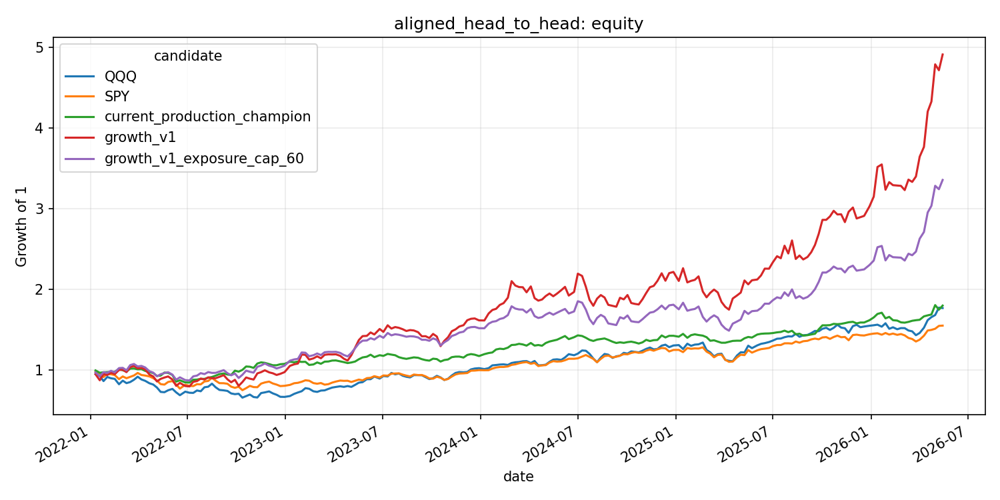
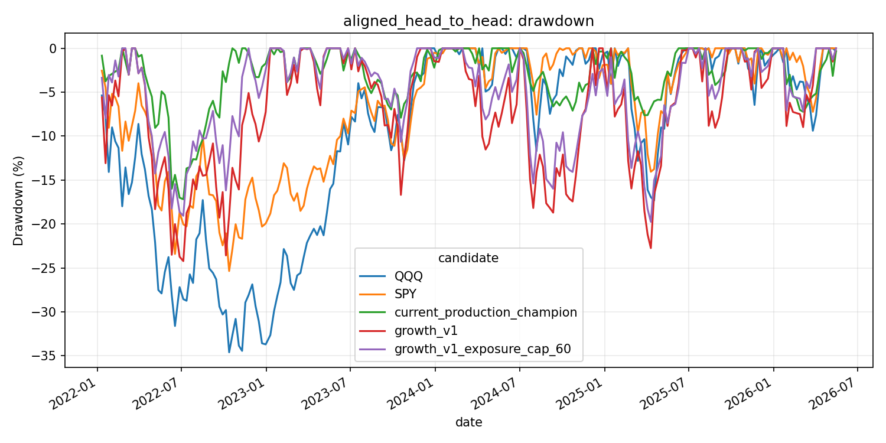
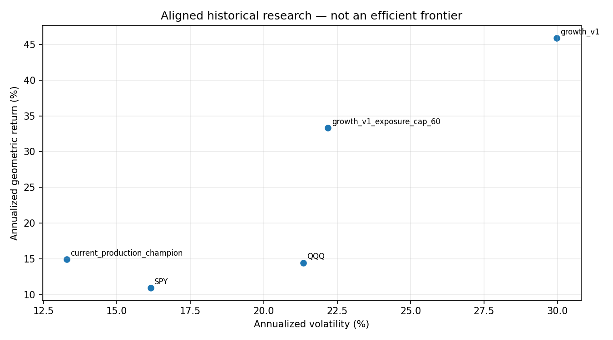
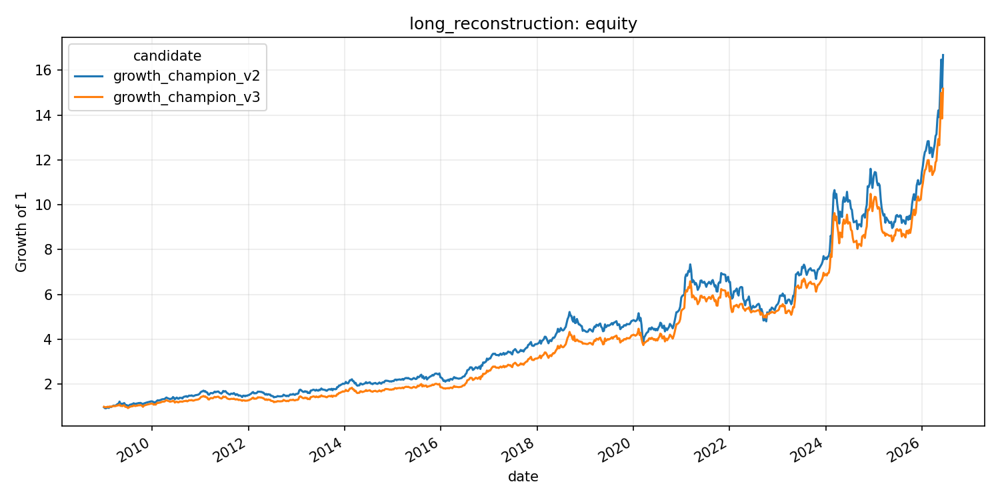
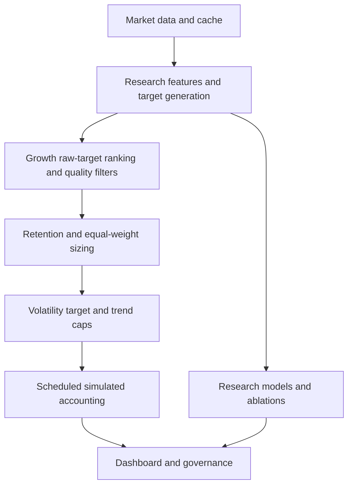

# The Machine Project | Quantitative Equity Research

[](https://github.com/santiago-pascual/The-Machine-Project/actions/workflows/ci.yml)

Independent, AI-assisted quantitative research and paper-trading engineering project by Santiago Pascual. The central question is whether a concentrated equity ranking strategy can retain meaningful historical performance under exposure constraints, trading costs and research-selection scrutiny. No institutional affiliation, real-money performance or independently demonstrated coding proficiency is claimed.

## Selected findings

- Historical uncapped and 60%-capped growth variants illustrate the trade-off between return and drawdown; neither constitutes validated investable alpha.
- The frozen paper model uses raw-target ranking, equal weights within exposure, a five-session rebalance and volatility/trend caps. The genetic optimizer and Black–Litterman are research components, not final Growth allocation rules.
- The legacy 21.32% result is an older baseline/old-regime-gate experiment, not the frozen model's continuous portfolio performance.
- Point-in-time universe coverage is unconfirmed. Research-wide multiple-testing governance remains adverse.

## Comparative historical evidence



All five series below are restricted to the same 219 recorded dates, 2022-01-10 to 2026-05-15. Recomputed from `data/growth_head_to_head_daily_returns.csv`; the dates are approximately weekly, not daily. Returns are recorded historical research returns, not fills or confirmed net returns. Annualization uses 52 observations/year, sample standard deviation, zero risk-free rate, downside RMS about zero and initial equity of one.

| Variant | Total return | Annualized geometric | Volatility | Sharpe | Sortino | Max DD | Mean exposure |
|---|---:|---:|---:|---:|---:|---:|---:|
| Growth v1 uncapped | 391.12% | 45.92% | 29.97% | 1.41 | 2.34 | -24.23% | 79.63% |
| Growth v1 cap 60 | 235.49% | 33.30% | 22.19% | 1.41 | 2.33 | -19.76% | 59.74% |
| Legacy comparator (`current_production_champion` in tape) | 79.59% | 14.92% | 13.29% | 1.11 | 1.76 | -17.18% | 45.07% |
| SPY | 54.73% | 10.92% | 16.15% | 0.72 | 1.06 | -25.36% | 100% |
| QQQ | 76.49% | 14.44% | 21.34% | 0.74 | 1.10 | -34.61% | 100% |

The first observation was excluded for all strategies because benchmark rows begin one date later. This explains differences from the original 220-row reports (uncapped +346.52%, capped +217.21%). This is date alignment, not a selection of a favorable subperiod. Actual execution intervals and benchmark adjustment consistency still need independent validation.




The historical selection report favored the capped variant despite lower CAGR. Later v3 dual-trend reconstruction improved several risk metrics against v2 in the archived overlapping start windows; these are not independent validation windows.

## Long-horizon reconstruction



2008-12-31 to 2026-06-09, 878 recorded observations each: v2 +1,567.98%, v3 +1,417.79%; maximum drawdowns -34.68% and -24.66%. These use reconstructed logic, not exact historical production parity. No claim of causal or survivorship-free reproduction is made. The full aligned and window-specific metrics are in [portfolio_metrics.csv](docs/portfolio/portfolio_metrics.csv).

## Architecture and paper infrastructure



The repository snapshot specifies paper-only operation: 22% volatility target, 60-day lookback, maximum four positions, 60% exposure ceiling, trend ceilings of 25/40/60%, five-session rebalances and next-session application of close signals. No real orders or broker connection are configured. The running environment was not inspected.

The official forward snapshot has 10 dated records from July 10 to August 13, 2026, with gaps. Gross compounded return is 7.91%; estimated net return compounds to 7.38%, while the terminal net cumulative field says 7.91%. The discrepancy prevents certifying the terminal net field. No annualized performance claim is made for this sparse sample. A separate 14-row exact-input history reports -8.72%; it is not merged with official forward records or reconstructed stress history.

## Quantitative methods and research governance

The research stack explores Kalman filtering, grid GARCH/EGARCH, HMM, spectral and wavelet measures, Hurst and OU proxies, event intensity, entropy, fractal measures, triple barriers, classifiers, calibration, covariance shrinkage and genetic optimization. Their implementation and limitations are documented in the [method audit](docs/portfolio/METHODOLOGY.md).

The older `deflated_sharpe_estimate` is a Sharpe difference, not a DSR probability. The later archived CSCV implementation reports below-median OOS ranks in 77.14%, 67.86% and 63.20% of partitions for 8, 10 and 12 blocks respectively. The code permits differing date coverage and uses a fixed daily annualization on mixed-frequency inputs. The 14,649 logged trial tally is not an independent trial count; the later effective-rank estimate of three pertains to a restricted 60-column matrix. Purged evaluation slices precomputed returns, not a complete model retraining and label-purging pipeline. See the [audit report](docs/portfolio/AUDIT.md).

## Offline reproduction and tests

Use a clean disposable checkout, not a live trading directory. Do not run daily, research, reset, replay, dashboard or archived entry points to reproduce this presentation. They may write state or fetch data.

```sh
python -m venv .venv
python -m pip install numpy pandas matplotlib pytest
python scripts/portfolio_audit.py --root . --out ../machine-audit-output
python -m pytest -q tests/test_portfolio_audit.py
```

Activate the virtual environment first (`.venv\Scripts\Activate.ps1` on Windows, `source .venv/bin/activate` on POSIX). This offline workflow reads recorded artifacts only, requires no market-data account and writes outside the input tree. It is not an end-to-end backtest. Python 3.13 was used for the artifact audit; existing CI targets 3.10/3.11, not yet independently verified here. The legacy requirements are unpinned.

## Documentation index

- [Audit, evidence hierarchy, engineering and limitations](docs/portfolio/AUDIT.md)
- [Quantitative methodology](docs/portfolio/METHODOLOGY.md)
- [Portfolio metrics](docs/portfolio/portfolio_metrics.csv) and [input hashes](docs/portfolio/source_hashes.txt)
- [Rolling risk](docs/portfolio/aligned_head_to_head_rolling_vol.png), [reconstructed drawdown](docs/portfolio/long_reconstruction_drawdown.png), [CSCV summary](docs/portfolio/cscv_summary.csv)

Dashboard screenshots and the original technical whitepaper are unavailable for verification in this snapshot; no substitute images or document have been fabricated.

## Author and license

Santiago Pascual — independent, AI-assisted research project. Existing software rights are reserved; no new license is granted by this documentation. Third-party market-data redistribution rights have not been established. Historical and simulated returns are not investment advice or guarantees of future results.
